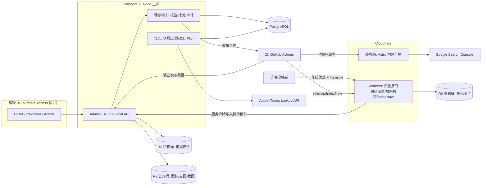
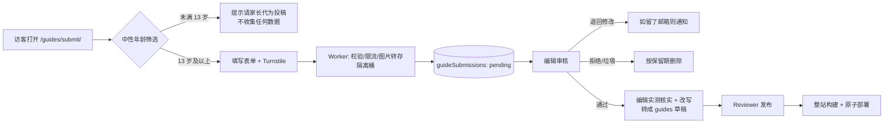

# 手机休闲益智小游戏测评推荐站 · 技术方案 v1.0

| 项 | 内容 |
|---|---|
| 对应产品文档 | 《手机端休闲益智小游戏测评推荐站产品设计文档 v1.0》 |
| 对应设计稿 | `design/review-site.pen`（首页、评测、榜单、方法页、比较页、手机评测页） |
| 日期 | 2026-11-08 |
| 状态 | 技术方案稿。未开始实现，未部署。文中价格、配额以各厂商官网为准，上线前复核。 |
| 核心目标 | 主要靠 Google 自然搜索获客：可抓取、快、结构化、内容可信、不触发垃圾内容政策 |

---

## 0. 结论速览

| 层 | 推荐 | 一句话理由 |
|---|---|---|
| 前台框架 | **Astro 6**，全部公开页面静态生成（SSG） | 内容站默认 0 JS，Core Web Vitals 最省心；HTML 里直接就是正文和分数 |
| 编辑后台 / CMS | **Payload 3**（TypeScript 代码定义数据模型） | 数据在自己的数据库里；草稿、版本、权限、钩子都能写成代码，适合“服务器权威计分 + 审计” |
| 数据库 | **PostgreSQL**（托管版） | 评分、快照、审计需要关系约束和事务 |
| 托管 / CDN | **Cloudflare**（静态资源 + Workers 少量动态接口 + R2 存图） | Astro 已被 Cloudflare 收购并一等支持；全球 CDN，静态站成本极低 |
| 图片 | R2 存原图，构建时生成 AVIF/WebP 多尺寸 | LCP 和 CLS 是图片站的主要风险 |
| 统计 | **Plausible**（无 Cookie）+ Google Search Console | 全年龄网站，避免默认上 GA4 这类带持久标识的追踪 |
| 商店数据 | iOS 用 Apple 官方 iTunes Lookup API；Android 由编辑手工录入并留证 | Google Play 没有可读取任意 App 的官方公开接口 |
| 用户投稿攻略（一期） | Worker 收稿 → Payload 审核队列 → 编辑核实后随整站构建发布 | 不做账号、先审后发，公开站仍是纯静态；详见第 9 章 |

**调研中最影响产品决策的四条发现**（详见第 10 章）：

1. **商店链接基本没有联盟佣金。** Apple 2018 年 10 月起已把 App 和应用内购从联盟计划中移除；Google Play 从未提供 App 联盟分成。产品文档第 12 章“联盟收入”这条路，对“导向官方商店”的主 CTA 基本不成立，需要改商业假设。
2. **AI 搜索在吃点击。** 多项 2026 年研究显示，出现 AI 概览时外链点击明显下降。纯“信息型”查询的流量会越来越难拿，需要把内容重心放在 AI 难以替代的第一手证据和比较决策上（第 6.6 节）。
3. **全年龄设计带来 COPPA 约束。** 新版 COPPA 规则的合规期限是 2026-04-22，已经生效。只要被认定为“面向儿童”或“混合受众”，在确认访客年龄前就不能收集个人信息、也不能给第三方广告/统计传数据。所以本方案默认不做行为追踪。
4. **Google 对评测内容的要求越来越具体。** 评测系统奖励第一手实测和证据；“批量生成、无增值”的页面属于垃圾内容政策里的规模化内容滥用。技术上必须把“薄页不发布”做成构建时的硬校验，而不是靠人自觉。

---

## 1. 为什么这样选：框架、CMS、托管的对比

### 1.1 前台框架：Astro vs Next.js

| 维度 | Astro 6 | Next.js（App Router） |
|---|---|---|
| 默认渲染 | 构建时生成静态 HTML | 服务器组件 / SSR，按请求渲染 |
| 默认发到浏览器的 JS | 约 0 KB，只有标了 `client:*` 的交互小组件才加载 JS | 至少有 React 运行时和 RSC 数据 |
| Core Web Vitals | 默认就好，难退化 | 能做好，但加一个 `'use client'` 就容易退化 |
| 适合 | 内容站、评测、榜单、文档 | 带登录、实时数据的应用 |
| 现状 | 2026-01 被 Cloudflare 收购，仍为 MIT 开源；Astro 6 于 2026-03 发布，开发环境可直接跑 Cloudflare 运行时 | 生态最大 |

本站前台全部是“读”的内容（评测、榜单、比较、方法页），交互只有筛选高亮、截图轮播、比较勾选这几处小组件。**选 Astro。** 交互组件用 Astro 岛（Preact 或原生 JS），按需加载。

### 1.2 CMS：Payload vs Strapi vs Sanity

| 维度 | Payload 3 | Strapi 5 | Sanity |
|---|---|---|---|
| 数据存哪 | 自己的 Postgres / SQLite / MongoDB | 自己的 SQL 数据库 | Sanity 托管的 Content Lake |
| 模型定义 | TypeScript 代码 | 可视化建模 + 文件 | 代码定义 Studio |
| 权限 | 代码函数，可细到字段 | 后台配置角色 | 角色，细粒度要高价套餐 |
| 钩子 / 事务 | 有，跑在同一进程，能在保存时算分、写审计 | 有生命周期钩子 | 需外接函数 |
| 托管 | 自托管（Payload Cloud 已暂停接新项目） | 自托管或 Strapi Cloud | 只能用托管 |
| 风险 | 2025-06 团队加入 Figma，官方称继续 MIT 开源 | 插件生态大 | 数据迁出成本高 |

产品文档要求“服务器权威计分、缺维不算分、改分必须审计、榜单读快照”，这些都是**数据库层的强约束**。Payload 能把这些规则写成代码和单元测试，数据又在自己的 Postgres 里。**选 Payload + Postgres。** 编辑人数少，不需要 Sanity 的实时协作。

### 1.3 托管

| 方案 | 说明 | 结论 |
|---|---|---|
| A. 全 Cloudflare：Astro 静态站 + Payload 跑在 Workers + D1 + R2 | Payload 官方有 Cloudflare 模板；但 D1 适配器仍是 beta，且必须用付费 Workers | 可以，但数据库用 beta 适配器有风险 |
| **B. 前台 Cloudflare，后台 Payload 跑在普通 Node 主机 + 托管 Postgres，媒体放 R2** | 前台和后台分开，后台挂了不影响线上页面 | **推荐** |
| C. 全 Vercel | 简单，但前台流量费用随规模涨得快 | 备选 |

推荐 B：**公开站点是纯静态文件，跟 CMS 完全解耦**。CMS 宕机、数据库维护都不会影响 Googlebot 抓取，这对 SEO 站最重要。Node 主机和 Postgres 厂商（如 Railway、Fly.io、Render、Neon、Supabase）上线前按预算再定，不影响架构。

---

## 2. 系统架构



**关键设计：一次发布 = 一次整站构建 = 一次原子部署。**

- 编辑点“发布”后，Payload 先在数据库事务里重算分数、重建受影响的 `RankingSnapshot`，再通知 CI 构建。
- CI 从 CMS 读取“已发布”数据，生成整站 HTML，一次性部署到 Cloudflare。新版本要么整体上线，要么整体不上线。
- 这样从根上杜绝产品文档担心的“评测页 7.5、榜单还是旧的 6.8”：两个页面来自同一次构建、同一份快照。
- 构建失败时线上保持上一版，CI 通知编辑。这正好对应文档里“快照失败保留上一次成功版本”的要求。

规模预估：首年页面数在几百到一两千之间，Astro 全量构建在几分钟内。超过约 1 万页再考虑按需渲染 + 缓存（Astro 6 已有实验性路由缓存），现阶段不需要。

---

## 3. 代码仓库结构

```
puzzle-review-site/
├─ apps/
│  ├─ web/              # Astro 6 前台（SSG）
│  └─ cms/              # Payload 3 后台
├─ packages/
│  ├─ scoring/          # 计分、舍入、并列、硬筛（纯函数，前后台共用，100% 单测）
│  ├─ seo/              # canonical / robots / JSON-LD / sitemap 生成器
│  └─ types/            # 由 Payload 生成的 TS 类型
├─ design/              # Pencil 设计稿与导出
├─ docs/                # 产品文档、本技术方案
└─ .github/workflows/   # 构建、测试、Lighthouse、部署
```

pnpm workspace 单仓。`packages/scoring` 是全站最重要的代码：CMS 保存时用它算分，构建时也用它校验，两边结果必须一致。

---

## 4. 数据模型（Payload Collections）

在产品文档第 7 章实体的基础上，按设计稿补了图片和家长须知字段。下表只列关键字段。

| Collection | 关键字段 | 约束 |
|---|---|---|
| `games` | `slug`（发布后锁定）、`name`、`developer`、`mechanicFamily`、`iosAppId`（唯一）、`androidPackage`（唯一）、`iosUrl`、`androidUrl`、`icon`、`keyArt`、`status` | 两个商店 ID 唯一，防重复建档；改 slug 必须写 301 记录 |
| `reviewVersions` | `game`、`platform`（ios/android）、`appVersion`、`osVersion`、`reviewType`（initial/full）、`testedFrom/To`、`testerRegion`、`storeLocaleObserved`、`methodologyVersion`、`dims`（G/A/F/C/U 各一个可空整数）、`compositeTenths`（只读）、`status`、`testingBoundaries`、`iapPurchased=false`、`authors` | `compositeTenths` 只能由钩子写入；客户端提交的值一律丢弃 |
| `dimensionNotes` | `reviewVersion`、`dim`、`rationale`、`evidence[]` | 每维必须有理由，才允许该维有分 |
| `observationLogs` | `session`、`playedOn`、`levelRange`、`type`（play/ad/iap/crash/offline/resume）、`adType`、`forced`、`resumedOk`、`body` | 广告日志是 A 维的证据来源，但不参与自动算分 |
| `tagVerifications` | `reviewVersion`、`tag`、`state`（yes/no/unknown）、`evidence`、`verifiedAt`、`verifiedOnline`（布尔） | `no_forced_ads=yes` 时要求 `verifiedOnline=true`，否则拒绝保存 |
| `familyNotes` | `storeAgeRating`、`ageRatingSource`、`ageRatingCheckedAt`、`hasIap`、`forcedAds`、`chatOrSocial`、`adsOpenOtherApps` | 设计稿新增的“家长须知”。只记录观察到的事实，不做儿童应用认证 |
| `evidence` | 文件（R2 私有桶）、`game`、`platform`、`appVersion`、`capturedAt`、`credit`、`publicAllowed` | 只有 `publicAllowed=true` 的文件才会复制到公开桶并出现在前台 |
| `rankingDefinitions` | `slug`、`title`、`listType`、`mechanicFamily`、`platformScope`、`hardFilters`、`minQualified`、`titleRule` | 保存时检查标题里的 “Top N” 与 `minQualified` 是否一致 |
| `rankingSnapshots` | `definition`、`generatedAt`、`methodologyVersion`、`items[]`（rank、game、reviewVersion、displayedTenths、tieGroup）、`source`（system/override） | 只增不改；前台只读最新一条成功快照 |
| `authors` | `name`、`slug`、`bio`、`role`、`photo` | 新增作者页 `/authors/{slug}/`，用于展示经验与专业性 |
| `redirects` | `from`、`to`、`code` | 构建时生成 Cloudflare `_redirects` |
| `auditEvents` | 对象、操作者、时间、字段、旧值、新值、原因 | 分数、状态、override 变更强制写入；只能追加 |
| `guideSubmissions` | `game`、`platform`、`appVersion`、`levelRange`、`title`、`body`（受限 Markdown）、`images[]`（隔离桶）、`penName`、`contactEmail`（可选）、`licenseAccepted`、`aiAssisted`、`ipHash`、`status`（pending/needs_changes/approved/rejected/spam）、`moderatorNotes` | 只能由 Worker 用服务令牌创建；前台和公开 API 都读不到；`ipHash` 7 天后清除，`contactEmail` 在处理完 30 天后清除 |
| `guides` | `game`、`slug`、`title`、`body`、`guideType`（walkthrough/tips/levels）、`levelRange`、`platform`、`verifiedOnVersion`、`source`（editorial/community）、`contributorName`、`verifiedBy`、`verifiedAt`、`status`、`mayBeOutdated` | 只有编辑能创建和发布；社区稿件由编辑从投稿转成正式攻略，投稿原文不直接上线 |

**权限**：用 Payload 的 access 函数按产品文档 7.4 实现：Editor 写草稿，Reviewer 发布或退回，Admin 管榜单定义和 override。后台入口再用 Cloudflare Access 加一层登录门禁，防止后台被扫描。

---

## 5. 计分与榜单实现

### 5.1 用整数计算，杜绝浮点和银行家舍入

- 维度分存成“十分位整数”：8.0 存成 80，7.5 存成 75，范围 0–100。
- 权重存成整数百分比 `{G:30, A:20, F:20, C:15, U:15}`，保存时断言总和为 100。
- 原始综合分：`raw = Σ weight × dimTenths`。例如 \(30×80 + 20×70 + 20×80 + 15×60 + 15×80 = 7500\)，代表 7.500。
- 展示分（十分位）：`displayedTenths = floor((raw + 50) / 100)`。7.25 对应 `raw=7250`，结果为 73，也就是 7.3；7.24 对应 `raw=7240`，结果为 72，也就是 7.2。全程整数运算，天然就是“逢五进位”。
- 任一维为空时返回 `null`，不是 0。

```ts
// packages/scoring/src/composite.ts
export const WEIGHTS_V1 = { G: 30, A: 20, F: 20, C: 15, U: 15 } as const;

export function composite(dims: Record<keyof typeof WEIGHTS_V1, number | null>) {
  let raw = 0;
  for (const [k, w] of Object.entries(WEIGHTS_V1)) {
    const v = dims[k as keyof typeof WEIGHTS_V1];
    if (v === null || v === undefined) return null;
    raw += w * v;
  }
  return { raw, displayedTenths: Math.floor((raw + 50) / 100) };
}
```

### 5.2 榜单快照算法

1. **硬筛**：完整评测、五维齐全、类别匹配、平台匹配、状态有效（未过期、未撤下），需求榜还要求对应标签为 `yes`。
2. **排序**：按 `displayedTenths` 从高到低；分数相同的条目内部只按名称排列显示顺序，不影响名次。
3. **竞赛式名次**：`rank = 1 + 比它分数高的条目数`，自然得到 1、2、2、4。
4. **命名校验**：合格数小于标题里的 N 时拒绝生成快照，后台提示改标题。
5. 写入新快照和审计事件，触发构建。

产品文档附录 B 的测试案例全部写成 `packages/scoring` 的单元测试：TC-SCORE-01 到 04、TC-RANK-01 到 04、TC-BIZ-01（加赞助标记前后快照完全相同）。CI 不通过不能部署。

### 5.3 定时任务

| 任务 | 频率 | 做什么 | 不做什么 |
|---|---|---|---|
| 过期检查 | 每天 | 评测满 90 天，或商店版本号变化，标记 `may_be_outdated` 候选并通知编辑 | 不自动改分 |
| iOS 商店同步 | 每天 | 调 iTunes Lookup（`country=us`）拉版本号、价格、年龄分级，存成带时间戳的商店快照 | 不把商店星级当作本站评分 |
| 快照重建 | 发布时 + 每天兜底 | 重算所有榜单 | 失败时不覆盖上一版 |

---

## 6. SEO 技术方案

### 6.1 渲染与抓取

- 所有可索引页面在构建时输出完整 HTML：标题、分数、五维、正文、FAQ、内链都在首个 HTML 响应里，不依赖 JS。
- 交互组件（榜单筛选高亮、截图轮播）只做增强。JS 不执行时内容依然完整。
- `robots.txt`：放行主流搜索爬虫，包括 Googlebot、Bingbot 和 AI 搜索爬虫 OAI-SearchBot。AI 训练类爬虫（如 GPTBot、Google-Extended）是否放行属于商业决策，列为待确认项，默认先放行搜索、单独决定训练。
- 预览环境整站 `noindex`，并加 HTTP Basic Auth，避免预览站被索引。

### 6.2 URL、canonical、索引规则（落实产品文档 6.1 和 8.3）

| 页面 | URL | 索引 | canonical |
|---|---|---|---|
| 评测 | `/reviews/{slug}/` | index | 自身 |
| 榜单 | `/rankings/{list}/` | index（快照合格数 ≥ `minQualified` 才发布） | 自身 |
| 榜单 + 查询参数 | `/rankings/{list}/?offline=yes` | `noindex,follow` | 回基础榜 |
| 类别 | `/categories/{slug}/` | 仅人工精选 | 自身 |
| 相似 | `/reviews/{slug}/similar/` | 同类完整评测 ≥ 2 才生成 | 自身 |
| 比较 | `/compare/{a}-vs-{b}/` | 两侧都是完整评测才生成；`a`、`b` 按字母序固定，反序 URL 301 到正序 | 自身 |
| 分页 | `/reviews/page/2/` | index | 自身（不指回第 1 页） |
| 作者 | `/authors/{slug}/` | index | 自身 |
| 攻略 | `/guides/{game}/{guide}/` | 编辑核实并发布后才生成 | 自身 |
| 单款游戏攻略汇总 | `/guides/{game}/` | 该游戏已发布攻略 ≥ 2 篇才生成；只有 1 篇时由评测页直接链接 | 自身 |
| 投稿页 | `/guides/submit/` | `noindex,follow` | 自身 |

查询参数版本只在客户端生成（静态站不会为每种筛选组合生成文件），canonical 和 noindex 由 Worker 或页面头部统一输出。比较页 URL 固定顺序，避免 A-vs-B 和 B-vs-A 产生重复内容。

### 6.3 薄内容闸门：做成构建失败，而不是靠人记

构建脚本在生成页面前逐项断言，违反就让构建失败或跳过该页面：

| 闸门 | 规则 | 对应政策 |
|---|---|---|
| 榜单数量 | 合格数 < `minQualified` 不生成；标题含 “Top N” 而合格数 < N 时构建失败 | 产品文档 5.4 |
| 相似页 | 同类完整评测 < 2 不生成 | 产品文档 6.2 |
| 比较页 | 任一侧非完整评测不生成；跨类别默认不生成 | 产品文档 6.2 |
| 需求榜 | 对应标签 `yes` 的合格游戏 < 5 不生成，首页入口显示 “list at 5 games” | 设计稿首页需求卡片 |
| 评测完整度 | 缺测试边界、缺商店链接、缺作者的评测不能发布 | Google 评测写作指南 |
| 字数与证据 | 完整评测至少要有五维理由和 1 张可公开证据图，否则发布时警告 | Google 评测系统 |
| 攻略 | 未核实、缺测试版本、正文过短，或与同游戏已有攻略关卡范围重复的，不生成页面；重复稿件合并而不是另开 URL | 垃圾内容政策：规模化内容滥用 |

这一层直接对应 Google 垃圾内容政策里的“规模化内容滥用”：页面数量只随实测增长，不会因为模板能生成就生成。

### 6.4 结构化数据（JSON-LD，由 `packages/seo` 统一生成）

| 页面 | 类型 | 要点 |
|---|---|---|
| 评测页 | `SoftwareApplication`（`applicationCategory: GameApplication`，`operatingSystem: iOS` 或 `Android`）+ 嵌套 `review` | `review.author` 为真实编辑；`reviewRating` 用本站分数，`bestRating: 10`、`worstRating: 0`；`offers.price` 填美国商店价格（免费填 0）。**不写 `aggregateRating`**，也不搬运商店星级 |
| 全站面包屑 | `BreadcrumbList` | 与页面上的面包屑一致 |
| 方法页 | `Article` | `author`、`datePublished`、`dateModified` 用真实日期 |
| 攻略 | `Article` | 社区攻略的 `author` 为投稿者笔名（`Person`），`editor` 为核实编辑；`dateModified` 取最近一次核实日期。Google 已停止展示 `HowTo` 富结果，不再输出 |
| 首页 | `Organization`、`WebSite` | 品牌名定下来后再填 |
| 榜单页 | `ItemList`（可选） | Google 目前只对少数类型（课程、电影、菜谱、餐厅）展示列表轮播，游戏榜单不会因此获得富结果。只用于帮助理解页面结构，不要指望它带来展示 |

Google 的评测摘要规则明确：评测必须基于真实体验，不能有未披露的利益交换；违规可能被人工处罚。赞助内容一律不输出 `Review` 标记。

### 6.5 Sitemap 与收录

- 按类型拆分：`sitemap-reviews.xml`、`sitemap-rankings.xml`、`sitemap-pages.xml`，加一个索引文件。
- `lastmod` 必须是页面真实的内容更新时间（评测版本发布时间、快照生成时间），**不能每次构建都写成今天**。Google 只在 `lastmod` 持续可信时才使用它。
- 只收录可索引页面：空壳、筛选组合、预览不进 sitemap。
- **Google**：Search Console 提交 sitemap；用 URL Inspection API 每天抽查新发布 URL 的索引状态，写进内部看板。Google 的 Indexing API 只适用于招聘和直播活动页，本站不能用。
- **Bing / Copilot**：部署后由 Worker 调 IndexNow 推送新增、更新、删除的 URL。IndexNow 只覆盖 Bing 等参与者，Google 不支持，所以不能替代 sitemap。

### 6.6 应对 AI 搜索分流

研究结论很一致：出现 AI 概览时外链点击明显减少。例如 2026 年一项 Chrome 扩展随机实验测得点击降 39.8%；Pew 观察到有 AI 摘要时点击传统结果的比例从 15% 降到 8%。AI 概览只引用 Google 已索引、且能显示摘要的页面，没有额外的技术开关。

技术侧能做的：

1. **把第一手数据做成机器可读、人也爱看的形式**：广告日志摘要（“前 60 关强制插屏出现在关卡之间，返回后棋盘完好”）、测试边界、版本与日期。这些是 AI 很难凭空生成的内容，也是被引用的理由。
2. **每页一个清晰的“答案块”**：评测页首屏的结论、五维分数和 FAQ 用语义化 HTML（`<dl>`、`<table>`、标题层级），方便被准确摘录。
3. **把精力放在 AI 不擅长代替的查询**：`{A} vs {B}`、`games like {X}`、带条件的需求榜（无强制广告、离线、单手），这类是决策型查询。
4. **度量**：Search Console 里分查询类型看展示和点击，区分“有展示没点击”是被 AI 概览截流，还是排名问题。

### 6.7 Core Web Vitals 预算（上线验收目标）

| 指标 | 目标（移动端 p75） | 手段 |
|---|---|---|
| LCP | ≤ 2.5 s | 首屏主图或游戏图标预加载；AVIF 优先；首屏主图压缩到 150 KB 以内；字体自托管并子集化（Astro 6 Fonts API） |
| INP | ≤ 200 ms | 每页 JS 不超过 50 KB；只有筛选和轮播是交互岛；不用重型第三方脚本 |
| CLS | ≤ 0.1 | 所有图片写死宽高比；广告位预留固定高度；字体用 `size-adjust` 回退 |

CI 里跑 Lighthouse CI，按模板（首页、评测、榜单、比较）设性能预算，超预算阻止合并。上线后用 Search Console 的 Core Web Vitals 报告看真实用户数据。

---

## 7. 图片与素材管线

| 素材 | 来源 | 处理 | 前台规则 |
|---|---|---|---|
| 游戏图标 | 编辑从官方商店页保存，iOS 也可从 iTunes Lookup 的 `artworkUrl512` 获取 | 构建时生成 64/128/256 尺寸 AVIF/WebP | 仅用于识别游戏，旁注版权归开发商 |
| 主图 | 官方商店页或开发商新闻资料 | 生成 640/1280/1920 宽度 | 注明来源；不包装成本站原创 |
| 测试截图 | 本站测试时自己截取 | 证据原件进私有桶；勾选 `publicAllowed` 的复制到公开桶并压缩 | 图注写游戏、平台、版本、截取日期 |
| AI 生成图 | 仅限设计稿和非游戏装饰图 | 写入 IPTC `DigitalSourceType = TrainedAlgorithmicMedia` 元数据 | 不得冒充真实游戏截图 |

商店徽章：设计稿用的是纯文字按钮（“View on the App Store”），没有用 Apple 官方徽章，可以不受徽章使用规范约束。若改用官方徽章，需遵守 Apple 营销规范：每个版面只放一个徽章、处于次要位置、不改不变形。另外 iTunes API 条款要求其返回的素材只用于推广商店内容，引用时要靠近商店入口。

---

## 8. 统计、隐私与儿童保护（全年龄设计的技术后果）

| 项 | 方案 |
|---|---|
| 访问统计 | Plausible：无 Cookie、无持久标识，按天轮换的哈希计算访客；支持自定义事件（Cloudflare Web Analytics 不支持自定义事件，也不记录 UTM） |
| 出站点击 | 商店按钮用 Plausible 自定义事件统计（游戏、平台、页面类型），不带用户标识 |
| 搜索数据 | Google Search Console（站长侧数据，不在访客端放脚本） |
| GA4 / 广告像素 | MVP 不接入。COPPA 下，被认定为面向儿童或混合受众时，确认年龄前不能收集个人信息，Cookie 标识也算个人信息 |
| 纠错 / 联系表单 | 只收邮箱和内容；表单写明“13 岁以下请让家长代为联系”；数据保留期写进隐私政策 |
| 攻略投稿 | 中性年龄筛选，未满 13 岁不收稿；邮箱可选；发布前人工去除个人信息。详见第 9 章 |
| 人机验证 | Cloudflare Turnstile，只用于表单 |
| 后台安全 | Cloudflare Access + Payload 自身登录；证据桶私有；预览链接带过期签名 |

新版 COPPA 规则的合规日期是 2026-04-22，要求包括给第三方披露数据（含广告和统计）要单独取得家长同意、披露第三方供应商名单、保留与删除策略等。以上只是技术默认值，**不构成法律意见**，上线前需美国律师确认网站定位。

---

## 9. 用户投稿攻略（一期）

一期不做评论，但开放攻略投稿。原则是：**不做账号、先审后发、编辑核实、与评分完全隔离**。公开站仍然是纯静态，投稿只是多了一个写入接口和一个审核队列。

### 9.1 流程



1. **投稿**：表单字段为游戏（从已建档游戏中选，不能自由填写，防止给不存在的游戏建页）、平台、游戏版本、关卡范围、标题、正文（受限 Markdown：标题、列表、加粗，禁止 HTML 和外链）、最多 6 张截图、笔名、可选邮箱、授权勾选、“是否使用 AI 辅助”申报。
2. **接收**：Cloudflare Worker 校验 Turnstile、按 IP 哈希限流（如每天 3 篇）、限制正文长度和图片大小，用服务令牌写入 Payload。浏览器不直连 Payload。
3. **审核**：编辑在 Payload 后台的审核队列里处理，状态有 pending、needs_changes、approved、rejected、spam。
4. **核实**：通过的稿件由编辑在当前版本上按攻略实际走一遍（至少抽查关键步骤），在 `guides` 里建立正式攻略，记录 `verifiedOnVersion`、`verifiedBy` 和日期。投稿原文不直接上线。
5. **发布**：和评测一样走“发布 → 整站构建 → 原子部署”。

### 9.2 与评测体系的隔离

- 攻略不影响任何分数、标签和榜单，`packages/scoring` 完全不读攻略数据。
- 攻略页显示 “Community guide · verified by {editor} on v{version}, {date}”，和编辑评测在视觉上区分开。
- 商店版本号变化时，过期任务把相关攻略标记 `mayBeOutdated`，页面显示提示，等编辑复核。不自动下线，也不自动改内容。
- 开发者或发行方投稿的攻略必须披露关系，按赞助内容处理。

### 9.3 儿童隐私（COPPA）

全年龄网站开放投稿，是本方案里 COPPA 风险最高的功能。技术默认值如下，**仍需律师确认**：

| 风险点 | 处理 |
|---|---|
| 未满 13 岁的投稿者 | 投稿前做中性年龄筛选：让用户自己填出生年月，不提示“必须满 13 岁”；未满 13 岁的不显示表单，用 `sessionStorage` 记住结果，防止返回重填。这一步不向服务器发送任何数据 |
| 正文里出现个人信息 | 表单提示“不要写真实姓名、学校、住址、好友码”；Worker 用正则标记疑似邮箱、电话、社交账号；编辑发布前人工删除 |
| 笔名 | 只显示笔名，禁止真实全名；不提供作者主页和联系方式 |
| 截图 | Worker 重新编码图片并去掉 EXIF（含 GPS）；编辑检查截图里的玩家名、头像、好友码，有就打码 |
| 邮箱 | 可选，只用于审核结果通知；稿件处理完 30 天后自动删除 |
| IP | 只存加盐哈希用于限流，7 天后清除 |
| 删除请求 | 投稿者（或家长）可凭投稿编号申请删除，编辑在后台一键删除稿件和图片 |

### 9.4 版权与平台责任

- 投稿条款：投稿者保证原创，授予本站非独占、永久、可编辑的使用许可；编辑可以改写和合并。
- 抄袭检测：提交时与站内已有攻略做相似度比对；编辑抽查是否抄自其他攻略站。
- 在美国版权局登记 DMCA 指定代理人，并在网站公布侵权通知渠道，才能对用户内容适用避风港规则。
- 游戏截图版权归开发商，只用于说明攻略步骤。

### 9.5 SEO 处理

- 攻略是长尾流量的主要来源，例如 “{game} level 45 solution”、“{game} tips”。只有核实后的攻略生成页面，未审核稿件永远不会出现在前台和 sitemap 里。
- 同一款游戏的同一关卡范围只保留一篇攻略，新投稿合并进旧文，不另开 URL，避免内容互相竞争和重复。
- 正文不允许外链；以后若开放，统一加 `rel="ugc nofollow"`。
- 申报使用 AI 辅助的稿件可以接受，但编辑必须实测核实；批量生成、没核实的稿件直接拒绝。
- 攻略页链接回对应评测、相似游戏和比较页，评测页也链接到该游戏的攻略，互相导流。

### 9.6 工作量与运营成本

- 技术：投稿 Worker、两个 collection、审核视图、图片隔离与转码、年龄筛选、攻略模板和汇总页，约增加 1.5–2 周工程量。
- 运营：每篇投稿审核加核实约 30–60 分钟（预估）。投稿量起来以后，审核产能和评测产能会争同一批编辑，需要单独排班。

---

## 10. 商业化的技术前提（需要回头改产品文档）

| 产品文档原假设 | 调研事实 | 建议 |
|---|---|---|
| 联盟合作带来收入 | Apple 2018-10 起对 iOS/Mac 应用和应用内购不再付佣金；Google Play 从未提供 App 联盟分成 | 主 CTA 指向官方商店，不能指望佣金。把联盟收入从“远期主收入”降级为“只在与具体发行商签约时才有” |
| 展示广告 | 全年龄定位下只能用上下文广告（不做个性化），收益偏低；还需按 COPPA 处理 | MVP 不放广告。若上广告，只用支持“面向儿童处理”标记的广告网络，并先过律师 |
| 赞助内容 | 可行，但赞助内容不能输出 `Review` 结构化数据，且必须显著披露 | 技术上在 CMS 加 `sponsored` 标记：自动加披露条、去掉评测 JSON-LD、排除出所有榜单计算 |
| 新增可能性 | 方法论透明、数据可复核，可以做开发者付费复测（不改分、结果公开）或数据授权 | 列为二期商业探索 |

---

## 11. 测试与质量门禁

| 层 | 内容 | 工具 |
|---|---|---|
| 单元测试 | 计分、舍入、并列、硬筛、标题校验、三态标签；附录 B 全部用例 | Vitest |
| 构建断言 | 薄内容闸门、每页唯一 canonical、无 `noindex` 页面进 sitemap、所有图片有宽高 | 构建脚本 |
| HTML 快照 | 抽样页面检查 `<title>`、canonical、robots、JSON-LD 字段 | Vitest + 解析构建产物 |
| 结构化数据 | JSON-LD 校验 schema；上线后用 Rich Results Test 抽查 | schema-dts 类型 + 人工 |
| 性能 | 各模板 Lighthouse 预算 | Lighthouse CI |
| 可访问性 | 对比度、按钮尺寸、图片 alt、键盘可用（全年龄用户必需） | axe-core |
| 链接 | 站内死链、商店链接 404 | lychee（每天） |
| 攻略投稿 | 年龄筛选未满 13 岁时不发任何请求；Turnstile 失败或超限被拒；HTML 和外链被剥离；图片 EXIF 被清除；未核实稿件不进构建产物和 sitemap；攻略数据变化前后榜单快照完全相同 | Vitest + Playwright |

TC-SEO-01（筛选页 noindex 且 canonical 回基础榜）和 TC-SEO-02（分页自 canonical）用 HTML 快照测试覆盖。

---

## 12. 实施计划（对齐产品文档 90 天计划）

| 阶段 | 时间 | 交付 |
|---|---|---|
| 0. 骨架 | 第 1–2 周 | 单仓、Payload 数据模型、`packages/scoring` 及全部单测、Astro 模板对照设计稿、CI 构建部署链路、预览环境 |
| 1. 闭环 | 第 3–5 周 | 发布 → 快照 → 构建 → 部署全链路；评测、榜单、方法页、比较页上线（内容可为空状态）；sitemap、robots、JSON-LD；Plausible |
| 2. 内容校准 | 第 4–8 周（与编辑并行） | 编辑录入 10 款完整评测；iOS 商店同步任务；证据与图片管线；薄内容闸门全部启用 |
| 2b. 攻略投稿 | 第 6–8 周 | 投稿 Worker、年龄筛选、审核队列、图片隔离转码、攻略页与汇总页模板；律师确认投稿条款与隐私政策后再开放 |
| 3. 收录与维护 | 第 8–13 周 | Search Console 与 URL Inspection 看板；IndexNow；过期与复测任务；Lighthouse 预算稳定达标；作者页 |

人力预估：1 名全栈工程师约 7.5–10 周可完成阶段 0–2b 的技术部分。编辑产能（每款完整评测至少 3 小时实际游玩，再加写作与证据整理）才是上线节奏的真正瓶颈。

---

## 13. 风险清单

| 风险 | 影响 | 缓解 |
|---|---|---|
| AI 概览持续分流 | 自然流量低于预期 | 侧重决策型查询与第一手数据；KPI 看出站点击而不只看会话数 |
| 被判定为面向儿童的服务 | 统计、广告、表单受 COPPA 约束 | 默认无追踪；上线前律师确认定位与文案 |
| 内容量少导致整站权重低 | 收录慢 | 不用薄页凑数；内链和作者页强化专业性；先做深一个品类 |
| Payload 被收购后路线变化 | 后台框架长期维护 | 数据在自己的 Postgres，迁移成本可控；计分逻辑在独立包里 |
| Google Play 数据要手工维护 | Android 版本号与价格可能过时 | 页面写明核对日期；过期任务提醒；不做抓取 |
| 构建变慢 | 发布延迟 | 万页以内全量构建可接受；之后再按需渲染 |
| 未满 13 岁用户投稿 | COPPA 违规 | 中性年龄筛选；发布前人工去除个人信息；邮箱可选并限期删除 |
| 投稿抄袭或侵权 | 版权投诉、搜索降权 | 原创承诺 + 相似度检测；登记 DMCA 代理人；先审后发 |
| 审核积压 | 投稿者流失，编辑没时间做评测 | 限流；队列设处理时限；必要时暂停投稿入口 |

---

## 14. 待确认事项

| 编号 | 事项 |
|---|---|
| T-01 | 是否接受“前台 Cloudflare、后台 Node 主机 + 托管 Postgres”的托管组合，以及具体厂商与预算 |
| T-02 | AI 训练类爬虫（GPTBot、Google-Extended 等）是否放行 |
| T-03 | 网站法律定位：一般受众 / 混合受众，由美国律师确认 |
| T-04 | 商业模式调整：接受“商店链接无佣金”的事实后，MVP 是否完全不放广告 |
| T-05 | 品牌名与域名（影响 `Organization` 结构化数据和 Search Console 资源） |
| T-06 | 投稿最低年龄：13 岁（需年龄筛选和更多隐私处理）还是 18 岁（更保守，但会挡掉青少年玩家） |
| T-07 | 是否给投稿者回报（署名之外的积分、奖品等）；涉及奖品要另走抽奖与促销法规 |
| T-08 | 攻略是否只开放给已有评测的游戏，还是所有已建档游戏都可以投稿 |

---

## 参考资料

- Google：[评测系统](https://developers.google.com/search/docs/appearance/reviews-system)、[如何写高质量评测](https://developers.google.com/search/docs/specialty/ecommerce/write-high-quality-reviews)、[垃圾内容政策](https://developers.google.com/search/docs/essentials/spam-policies)、[生成式 AI 内容指南](https://developers.google.com/search/docs/fundamentals/using-gen-ai-content)、[评测摘要结构化数据](https://developers.google.com/search/docs/appearance/structured-data/review-snippet)、[SoftwareApplication 结构化数据](https://developers.google.com/search/docs/appearance/structured-data/software-app)
- Astro / Cloudflare：[Astro 加入 Cloudflare](https://blog.cloudflare.com/astro-joins-cloudflare/)、[Astro 6.0 发布](https://astro.build/blog/astro-6/)、[@astrojs/cloudflare](https://docs.astro.build/en/guides/integrations-guide/cloudflare/)
- Payload：[Payload on Workers](https://blog.cloudflare.com/payload-cms-workers/)、[Cloudflare D1 模板说明](https://github.com/payloadcms/payload/blob/main/templates/with-cloudflare-d1/README.md)、[Payload vs Strapi vs Sanity 2026](https://znovastudio.com/insights/payload-vs-strapi-vs-sanity)
- 商店数据：[iTunes Search API](https://developer.apple.com/library/archive/documentation/AudioVideo/Conceptual/iTuneSearchAPI/)、[Google Play Developer API（仅限自有应用）](https://developer.android.com/google/play/developer-api)、[Apple 营销素材与徽章规范](https://developer.apple.com/app-store/marketing/guidelines/)
- 联盟：[TechCrunch：Apple 结束 App Store 联盟计划](https://techcrunch.com/2018/08/01/apple-is-ending-its-app-store-affiliate-program-in-october/)、[Ars Technica 报道](https://arstechnica.com/gaming/2018/08/apple-shuts-app-store-affiliate-program-imperiling-recommendation-sites/)
- 收录：[IndexNow FAQ](https://www.indexnow.org/faq)、[Bing IndexNow 接入](https://www2.bing.com/indexnow/getstarted)
- AI 搜索影响：[SSRN：AI 概览对出版商流量的田野实验](https://papers.ssrn.com/sol3/papers.cfm?abstract_id=6513059)、[arXiv：AI 搜索减少出版商引流](https://arxiv.org/html/2608.18352)、[Digital Content Next 综述（2026-10）](https://digitalcontentnext.org/blog/2026/10/05/the-evidence-is-clear-ai-search-is-costing-publishers/)
- 儿童隐私：[COPPA 修订规则（联邦公报）](https://www.federalregister.gov/documents/2025/04/22/2025-05904/childrens-online-privacy-protection-rule)、[16 CFR Part 312](https://www.ecfr.gov/on/2025-06-23/title-16/chapter-I/subchapter-C/part-312)、[Plausible 数据政策](https://plausible.io/data-policy)、[FTC COPPA 常见问题（含年龄筛选）](https://www.ftc.gov/business-guidance/resources/complying-coppa-frequently-asked-questions)
- 用户内容：[Google：用户生成内容的链接属性](https://developers.google.com/search/docs/crawling-indexing/qualify-outbound-links)、[Google 停用 HowTo 富结果](https://developers.google.com/search/blog/2023/08/howto-faq-changes)、[美国版权局 DMCA 指定代理人目录](https://www.copyright.gov/dmca-directory/)
